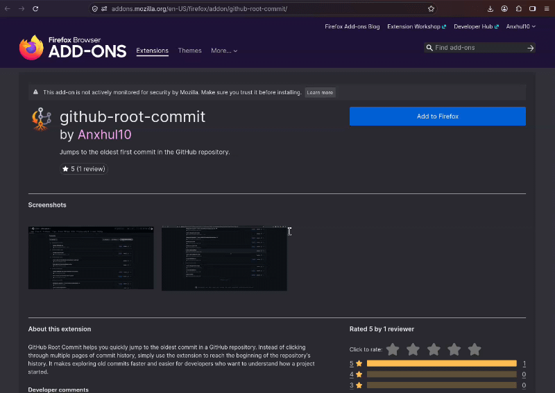

# GitHub Root Commit

Ever wondered what the first commit of React, Git, or VS Code looked like?

Stop scrolling through thousands of commits. **Jump straight to the beginning with GitHub Root Commit.**

## Demo



## Installation

**Firefox:** [Install GitHub Root Commit](https://addons.mozilla.org/en-US/firefox/addon/github-root-commit/)

**Chrome:** Not published on the Chrome Web Store yet.

For now, you can manually install the extension by following this guide:

[How to manually install a Chrome extension](https://www.ssl2buy.com/wiki/how-to-manually-install-a-chrome-extension-in-2-ways)

> Note: Manual installation instructions and supported extension formats may vary depending on your browser and extension manifest.

## Development

Run the extension locally in Firefox:

```bash
web-ext run
```

Build the extension for distribution:

```bash
web-ext build
```

The build command packages the extension into a ZIP file in the `web-ext-artifacts/` directory, ready for submission or distribution.

## Acknowledgements

This project was inspired by a solution shared on Stack Overflow:

- [Stack Overflow – Original answer](https://stackoverflow.com/a/49647826/25622129)
